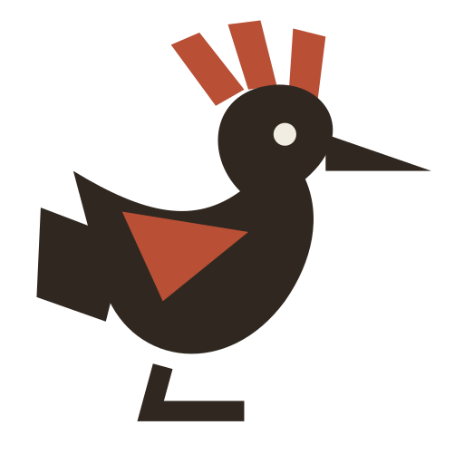
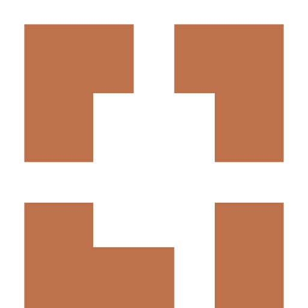

<h1 align="center">Mohsen Abd Elkareem</h1>

  <b>Founder & CEO @ <a href="https://eilyatech.com">EilyaTech</a></b> · Mobile Architect · 10+ years building Android, Flutter & KMP apps

  
  
  
  
  

---

### About

I build **applied AI products for Arabic-speaking creators and businesses** at EilyaTech, in
Alexandria, Egypt. Before founding it, I spent 10+ years as a **Senior Mobile Engineer and Mobile
Team Lead**. I shipped production apps in Kotlin, Jetpack Compose, Flutter and Kotlin
Multiplatform, designed complex HMI-style UI systems, and led teams that ship reliably.

### What I'm building

| | Product | What it does |
|---|---|---|
| <picture><source media="(prefers-color-scheme: dark)" srcset="assets/eilyatech-dark.svg"></picture> | **[EilyaTech](https://eilyatech.com)** | The company: applied AI for Arabic creators and businesses |
| <picture><source media="(prefers-color-scheme: dark)" srcset="assets/eilya-studio-dark.svg"></picture> | **Eilya Studio** | An Arabic-first AI content studio: from an idea to a published short video in your own dialect, from one phone |
|  | **Eilya Flow** | Customer engagement and workflows: WhatsApp and Facebook leads become automated conversations, broadcasts and one shared inbox |

### Expertise

  

| Area | Stack |
|---|---|
| **Android** | Kotlin · Jetpack Compose · Coroutines & Flow · Room · WorkManager · Paging · Retrofit |
| **Cross-platform** | Flutter · Dart · Kotlin Multiplatform (KMP) |
| **Architecture** | Clean Architecture · MVVM / MVI · modular codebases · offline-first |
| **UI systems** | HMI-style interfaces, multi-state screens, advanced navigation, performance tuning |
| **Delivery** | CI/CD with GitHub Actions · Firebase App Distribution · unit testing (JUnit, Mockito) |
| **Leadership** | Leading mobile teams · code reviews · architecture decisions · mentoring |

### Teaching

I explain programming in plain Arabic on **[Programming Bebasata](https://www.youtube.com/@mohsen.abd.elkareem)**:
practical Android, Kotlin, Flutter and mobile-architecture tutorials for developers who want to
build better apps.

### Let's talk

Partnerships, investment, or building something together:
**[mohsen@eilyatech.com](mailto:mohsen@eilyatech.com)** · **[eilyatech.com](https://eilyatech.com)**

<b>Create. Connect. Move.</b>

